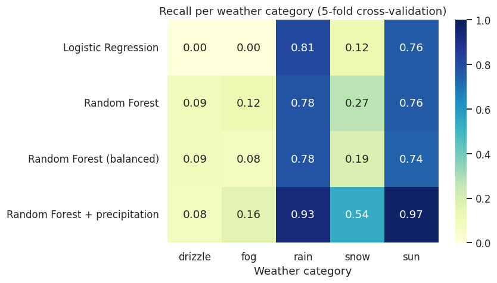
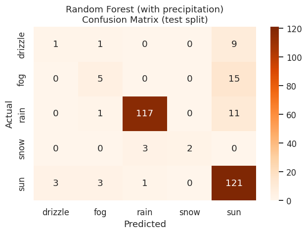
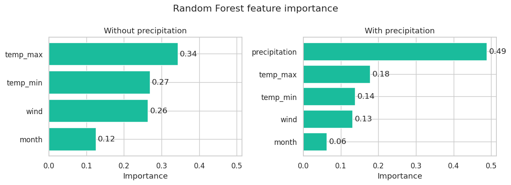

# Weather Category Prediction Using Machine Learning

Classifies the **weather category of a day** (`sun`, `rain`, `fog`, `drizzle`, `snow`) from its temperatures, wind and month, using Logistic Regression and Random Forest. The project focuses on honest evaluation of an **imbalanced** dataset: cross-validation, macro F1 and per-class recall, not just accuracy.

> **This is classification of same-day measurements, not a weather forecast.**

## Dataset

[vega-datasets `seattle-weather.csv`](https://raw.githubusercontent.com/vega/vega-datasets/main/data/seattle-weather.csv): 1,461 daily rows from 2012-01-01 to 2015-12-31, no missing values. A copy is included in `data/`; the notebook downloads it automatically if the file is not found.

| Weather category | Days | Share |
|---|---|---|
| rain | 641 | 43.9% |
| sun | 640 | 43.8% |
| fog | 101 | 6.9% |
| drizzle | 53 | 3.6% |
| snow | 26 | 1.8% |

Always predicting `rain` would already give **43.9% accuracy**, so that is the number to beat.

## Approach

1. Extract `month` from `date`.
2. **Scenario 1:** features `temp_max`, `temp_min`, `wind`, `month` (Logistic Regression baseline and Random Forest).
3. **Scenario 2:** the same features plus `precipitation`.
4. Evaluate with a stratified 80/20 split (`random_state=42`) and **5-fold stratified cross-validation**, because the test split contains only about 5 snow days.
5. Try extra ideas (yesterday's weather, Gradient Boosting, forecasting tomorrow) and look at feature importance.

## Results (5-fold cross-validation, mean ± std)

| Model | Features | Accuracy | Macro F1 |
|---|---|---|---|
| Always predict `rain` | none | 0.439 | – |
| Logistic Regression | without precipitation | 0.692 ± 0.013 | 0.322 ± 0.032 |
| Random Forest | without precipitation | 0.691 ± 0.009 | 0.430 ± 0.014 |
| Random Forest (balanced class weights) | without precipitation | 0.678 ± 0.015 | 0.393 ± 0.026 |
| Random Forest | **with** precipitation | 0.852 ± 0.012 | 0.552 ± 0.049 |

### Recall per category



### Example confusion matrix (Random Forest with precipitation, test split)



## Things I tried

All with the same 5-fold cross-validation.

| Experiment | Accuracy | Macro F1 |
|---|---|---|
| Today's weather, Random Forest (reference) | 0.691 | 0.430 |
| + yesterday's weather as features | 0.702 | 0.461 |
| Gradient Boosting instead of Random Forest | 0.663 | 0.405 |
| **Forecast tomorrow** from today (Random Forest) | 0.627 | 0.362 |
| Rule, no model: tomorrow = today | 0.632 | – |
| Rule, no model: tomorrow = rain | 0.439 | – |

- Yesterday's weather helps a little.
- Gradient Boosting is not better on a dataset this small.
- The tomorrow forecast does **not** beat the "tomorrow = today" rule, so with four years of data and these features the model learns nothing useful about the future.

## Feature importance



Without precipitation, the temperatures and wind carry most of the signal. With it, `precipitation` alone accounts for about half of the importance (0.49). Impurity-based importances can favour continuous features, so read this as a rough ranking.

## What the results show

- **Random Forest is not more accurate than Logistic Regression** without precipitation (both about 69%). It is better on rare classes: macro F1 is 0.43 against 0.32, and it recognises some `snow` and `fog` days that Logistic Regression misses entirely.
- **Adding precipitation raises accuracy to about 85%.** In this dataset precipitation is 0 on every `sun`, `fog` and `drizzle` day, so the model is partly reading the answer from a variable tied to the label.
- **Class imbalance is the main weakness.** `rain` and `sun` have recall of about 0.8 (0.9+ with precipitation), but `drizzle` recall stays below 0.1 in every scenario. High overall accuracy hides this.
- `class_weight="balanced"` did not improve cross-validated results.

## Limitations

- One city and four years of data.
- Only 26 snow and 53 drizzle days, so per-class results for them are uncertain.
- The `weather` label does not always match the precipitation measurement (44 `rain` days have 0 precipitation).
- The models use same-day measurements, so they cannot forecast tomorrow's weather.

## How to run

**Google Colab:** upload `Weather_Prediction_Using_Machine_Learning.ipynb` and run all cells (the data downloads automatically).

**Locally:**
```bash
git clone https://github.com/harpreetsingh171190-cmyk/<repository-name>.git
cd <repository-name>
python -m venv .venv
source .venv/bin/activate          # Windows PowerShell: .venv\Scripts\Activate.ps1
pip install -r requirements.txt
jupyter notebook Weather_Prediction_Using_Machine_Learning.ipynb
```

## Project structure

```text
├── Weather_Prediction_Using_Machine_Learning.ipynb
├── data/seattle_weather.csv
├── images/                    # charts shown in this README
├── requirements.txt
├── LICENSE
└── README.md
```

## Next steps

- [ ] Use more years of data and more variables (pressure, humidity, cloud cover).
- [ ] Tune hyperparameters with nested cross-validation.
- [ ] Revisit the tomorrow forecast with richer data.

## Author

**Harpreet Singh** · [GitHub](https://github.com/harpreetsingh171190-cmyk) · [Portfolio](https://harpreet-singh-portf-jqfs.bolt.host)

## License

MIT License. See [LICENSE](LICENSE).
